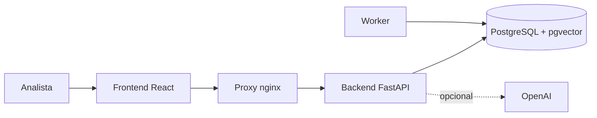

# Radar Leilão

Plataforma em português do Brasil para análise rastreável de imóveis em **leilões extrajudiciais**. Transforma dados, documentos,
processos, débitos, custos e mercado em um dossiê versionado do imóvel, com checklist, riscos, análise financeira e veredito explicável.

> Ambiente de homologação em VPS (HTTP, sem TLS). Não use dados sensíveis. Detalhes em [docs/04-operations/infrastructure.md](docs/04-operations/infrastructure.md).

## Em uma linha

Imóvel → documentos → texto e RAG → agentes e motores → evidências → checklist → riscos → veredito → histórico.



## Stack

React 19 + TypeScript + Vite · FastAPI + SQLAlchemy + Alembic · PostgreSQL 16 + pgvector · LangChain/LangGraph · Docker Compose · GitHub Actions + GHCR.

## Executar localmente

Pré-requisito: Docker Desktop (com WSL2 no Windows).

```bash
./scripts/setup.sh      # primeira vez
./scripts/start.sh
./scripts/health.sh
```

Frontend: http://localhost:5173 · API: http://localhost:8000/docs. `./scripts/reset.sh` apaga dados.
Guia completo: [docs/05-development/getting-started.md](docs/05-development/getting-started.md).

Sem `OPENAI_API_KEY` o sistema funciona, mas embeddings e agentes de IA ficam indisponíveis (status `SEM_CHAVE`).

## Publicar uma versão

Uma tag `vX.Y.Z` na `main` dispara CI, publicação das imagens no GHCR e deploy na VPS. Ver [docs/04-operations/github-actions.md](docs/04-operations/github-actions.md).

## Documentação

| Quero... | Vá para |
|---|---|
| entender o produto e as regras | [docs/01-business](docs/01-business/README.md) |
| ver módulos, status e roadmap | [docs/02-product](docs/02-product/README.md) |
| entender a arquitetura e os diagramas | [docs/03-architecture](docs/03-architecture/README.md) |
| operar a VPS, deploy, backup | [docs/04-operations](docs/04-operations/README.md) |
| desenvolver, testar, contribuir | [docs/05-development](docs/05-development/README.md) e [CONTRIBUTING.md](CONTRIBUTING.md) |
| conhecer qualidade e limitações | [docs/06-quality](docs/06-quality/README.md) |
| achar um documento antigo | [docs/99-archive](docs/99-archive/README.md) |

Índice geral e inventário: [docs/README.md](docs/README.md).

## Regras que não mudam

- Schema só por Alembic; nunca `create_all` em runtime.
- Nada de `docker compose down -v`, `DROP` ou `TRUNCATE` no ambiente com dados.
- Segredos nunca no repositório (este repositório é público).
- Documentação atualizada na mesma entrega da mudança.
