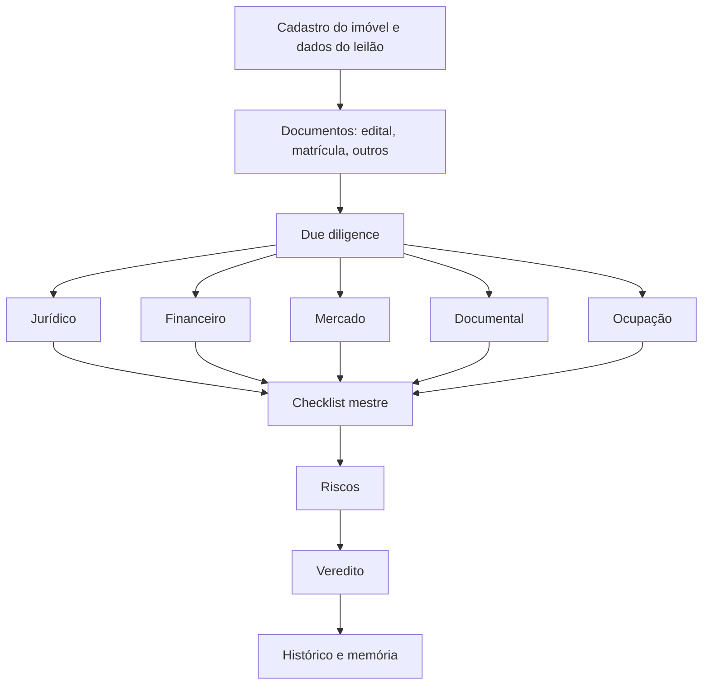

# Visão do produto

## 1. O que é

O Radar Leilão é uma plataforma de inteligência para analisar imóveis em **leilões extrajudiciais** (alienação fiduciária,
Lei 9.514/97). Ele transforma dados cadastrais, documentos (edital, matrícula), processos, débitos, custos e informações de
mercado em um **dossiê vivo, rastreável e versionado** do imóvel, com checklist, riscos, análise financeira e veredito
explicável.

Não é um chatbot nem apenas um leitor de PDF. É um sistema de conhecimento acumulativo: cada nova informação enriquece o
dossiê, preserva o histórico e recalcula só o que foi afetado.

## 2. Para quem

Investidor ou analista que avalia a compra de imóveis em leilão e precisa decidir com evidências. O produto atende um perfil
de uso individual ou de pequena equipe; papéis do sistema (ADMIN, ANALISTA, OPERADOR, CONSULTA) estão em
[../03-architecture/security.md](../03-architecture/security.md).

## 3. Filosofia do produto

Princípios herdados da especificação mestre e confirmados no código:

1. **O imóvel é a entidade central.** Documentos, processos, débitos, custos, checklist, riscos e histórico pertencem a ele.
2. **Análise progressiva.** A primeira análise pode ser incompleta; V1 pode ter só edital e matrícula, V2 inclui um processo, V3 um débito, e assim por diante. Cada versão guarda o conhecimento daquele momento.
3. **Nada importante é sobrescrito.** Documentos originais são imutáveis; análises, evidências e resultados são versionados, e deve ser possível saber por que um resultado mudou.
4. **IA interpreta; o sistema determina.** Cálculos e regras determinísticas ficam em código (por exemplo, o motor financeiro). A IA lê documentos, relaciona evidências e explica, sempre com evidência e nível de confiança.
5. **Toda conclusão importante tem evidência.** Sem evidência, o resultado fica pendente ou inconclusivo, nunca "favorável por omissão".
6. **O veredito não esconde incerteza.** Ele diz o que se sabe, o que não se sabe, quais riscos existem, quais evidências os sustentam, o impacto financeiro, as pendências e o que mudou.
7. **Um dado ausente não vira zero.** O motor financeiro trata ausência como desconhecido e marca o resultado como provisório.
8. **Português do Brasil** em toda a experiência funcional.

## 4. Fluxo de negócio

O usuário também alimenta o dossiê depois do cadastro: processos pesquisados, movimentações, débitos, custos, orçamento de
reforma, comparáveis de venda e aluguel, ocupação, novos editais e matrículas.

## 5. Escopo

- **Dentro:** leilão extrajudicial; cadastro; documentos e RAG; jurídico; financeiro; mercado; ocupação; checklist; riscos; veredito; histórico; due diligence; pós-arrematação; administração; autenticação por papéis.
- **Fora (por decisão da especificação):** leilão judicial não faz parte da V1 (existe um módulo de consulta judicial separado, `judicial_api/`, como integração de pesquisa de processos; ver [integrations](../03-architecture/integrations.md)).
- **Natureza:** MVP. Fundamentos robustos, operação simples; sem dezenas de microsserviços.

## 6. Onde ver o produto hoje

Status por módulo, com divergências e limitações: [../02-product/README.md](../02-product/README.md).
Roadmap atual: [../02-product/roadmap.md](../02-product/roadmap.md).
