# Arquitetura

Visão da arquitetura **atual** do Radar Leilão, com 11 diagramas Mermaid. Convenção: elementos com borda tracejada e rótulo
"(planejado)" ou "(sem cliente)" **não existem** hoje ou não têm integração implementada. Substitui o antigo `ARCHITECTURE.md`
(arquivado: mostrava proxy 80/443 com HTTPS e 143 paths, e o estado atual é HTTP 80 e 144 paths).

## Visão em uma tabela

| Camada | Tecnologia |
|---|---|
| Frontend | React 19, Vite 6, TypeScript 5.7, lucide-react; testes com vitest 2.1.8 e testing-library; **sem react-router** |
| Backend | Python 3.12, FastAPI 0.115, uvicorn, SQLAlchemy 2.0, Alembic 1.14, pydantic-settings |
| IA | LangChain 0.3, LangGraph 0.2, OpenAI (gpt-4o-mini, text-embedding-3-small), MarkItDown, Tesseract (OCR desabilitado) |
| Banco | PostgreSQL 16 com pgvector (`pgvector/pgvector:pg16`) |
| Proxy | nginx 1.27-alpine (portão por cookie, rate limit de login, `/docs` oculto) |
| Deploy | Docker Compose em uma VPS Contabo; imagens no GHCR; GitHub Actions por tag |

## 1. Contexto do sistema

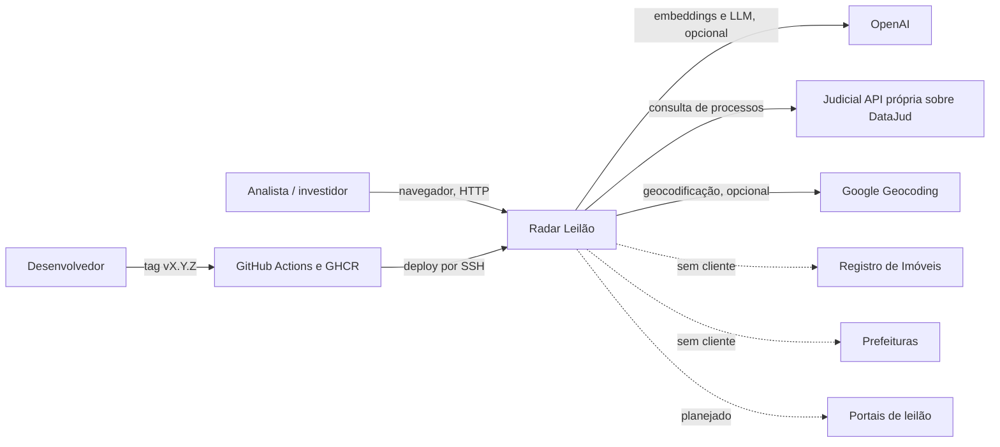

## 2. Containers (produção, `docker-compose.prod.yml`, projeto `radar-prod`)

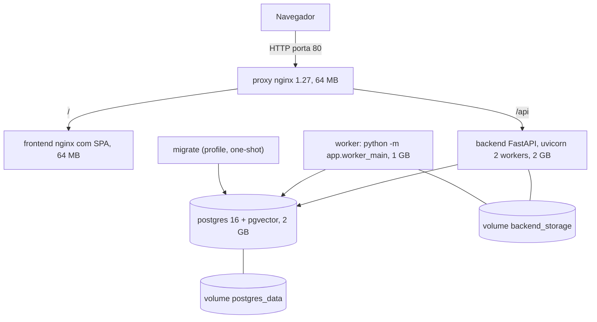

O desenvolvimento (`docker-compose.yml`) expõe postgres 5432, backend 8000, `judicial_api` 8010 e frontend 5173; a `judicial_api`
**não** está no compose de produção.

## 3. Backend

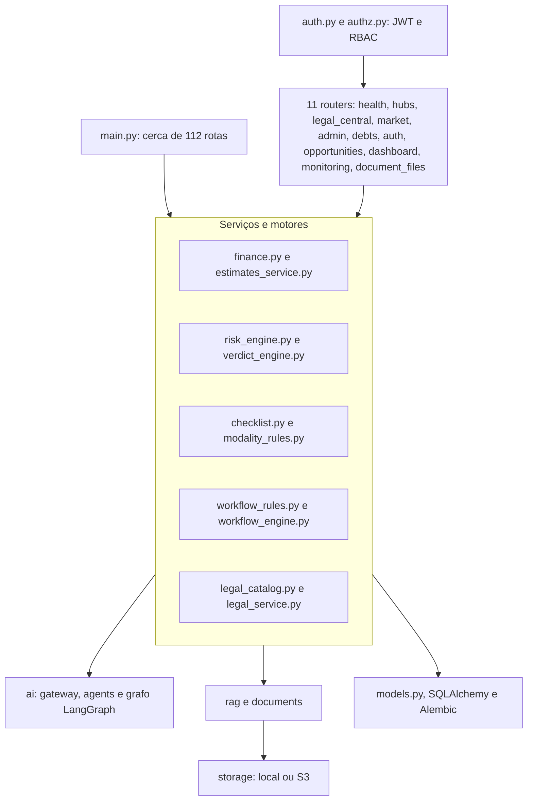

## 4. Frontend

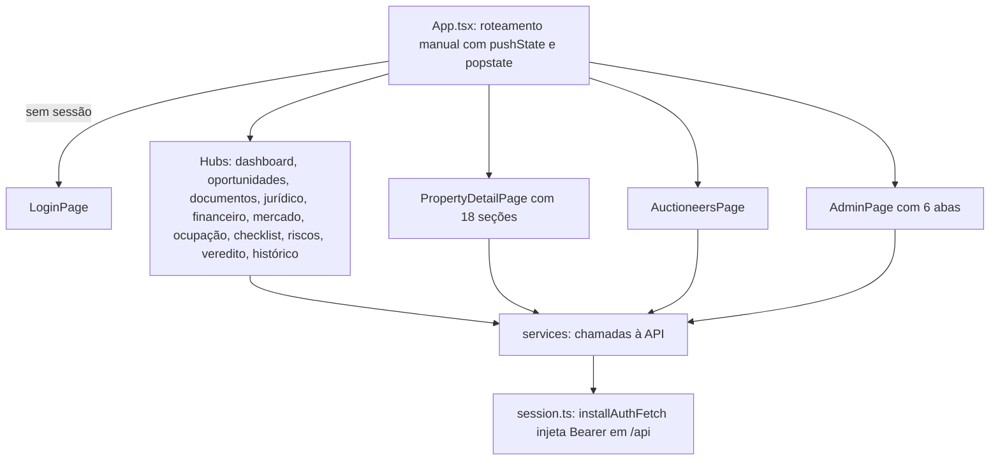

## 5. Persistência

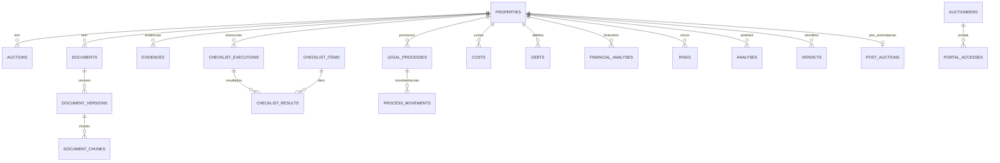

São 60 tabelas e 23 migrations (`0001_fundacao_radar` a `0023_usuarios`); o diagrama mostra o núcleo. Ver [data-model.md](data-model.md).

## 6. Autenticação e autorização

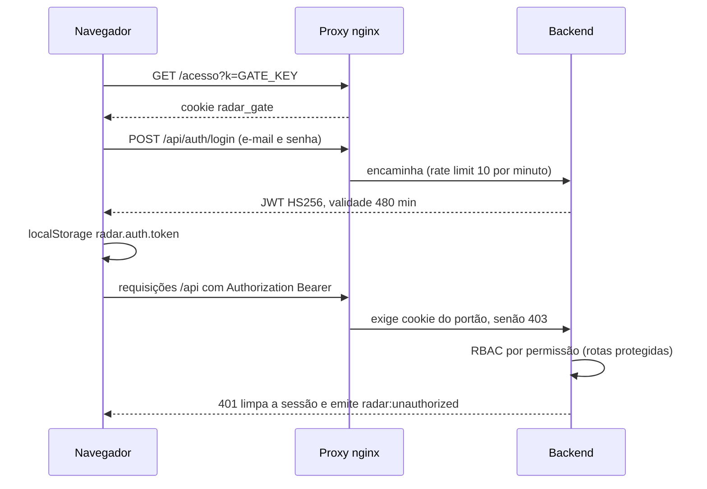

Duas camadas independentes: o portão do proxy (todas as rotas) e o JWT com RBAC (apenas as rotas protegidas; 148 de 184 rotas não exigem credencial no backend).

## 7. Análise de oportunidade (workflow)

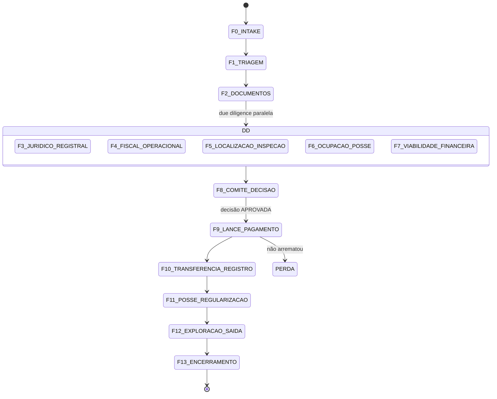

DESCARTE é possível a partir de qualquer fase exceto F13; hard stops bloqueiam o avanço; eventos de invalidação reabrem fases.

## 8. Análise financeira

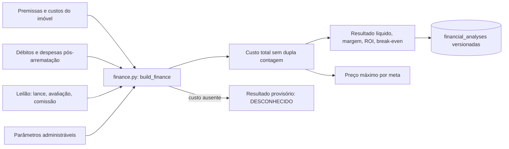

Cenário BASE implementado; OTIMISTA e PESSIMISTA, TIR/VPL e sensibilidade são planejados.

## 9. Análise documental e jurídica

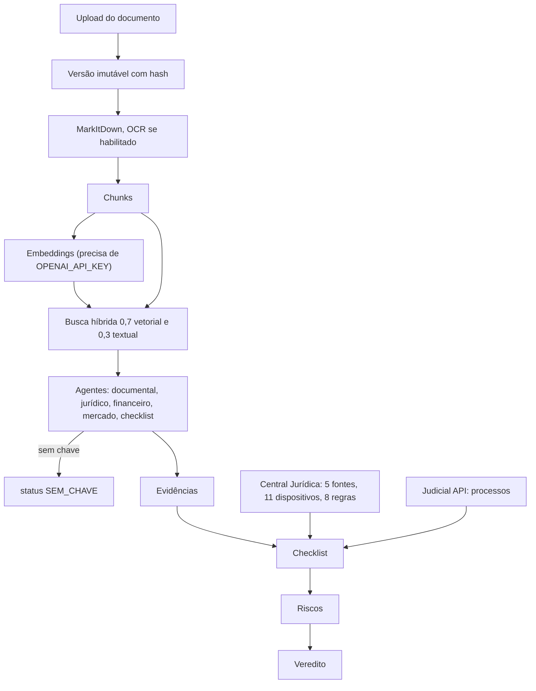

## 10. Integrações

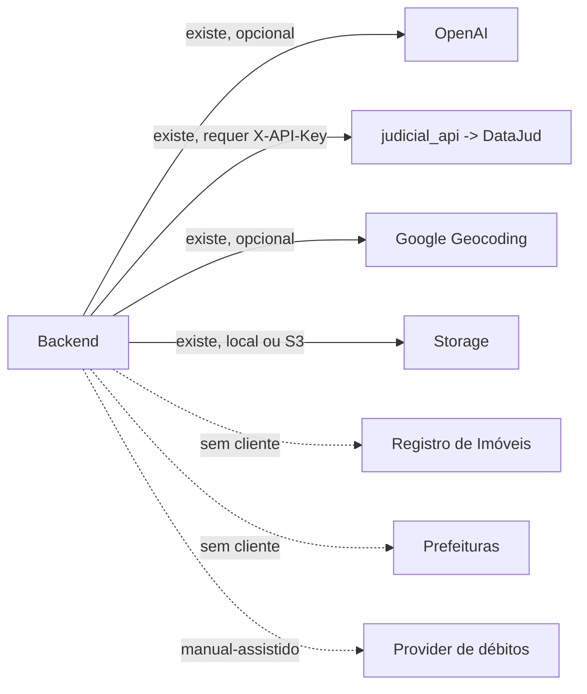

Detalhes em [integrations.md](integrations.md).

## 11. Infraestrutura e deploy

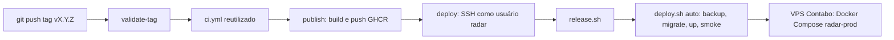

Operação: [../04-operations/infrastructure.md](../04-operations/infrastructure.md) e [../04-operations/github-actions.md](../04-operations/github-actions.md).
